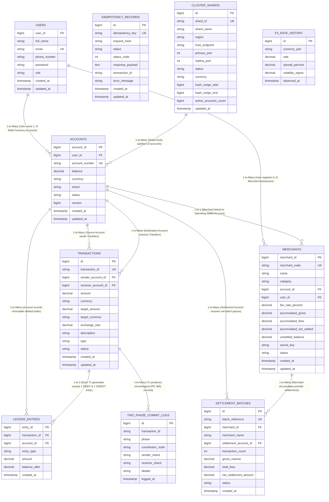

# TransMoney Distributed Digital Wallet - Entity Relationship (ER) & DDBMS Architecture

**Course:** Distributed Database Systems (Sir Umair)  
**Academic Team:** Shehzad Nisar (B22110006147), Muhammad Ashraf (B22110006090), Daniyal Ahmed (B21110006024)  
**Target Engine:** PostgreSQL 17  
**Architecture:** Shared-Nothing Horizontally Sharded Architecture with Two-Phase Commit (2PC) Consensus  

---

## 1. Visual Entity Relationship (ER) Diagram

---

## 2. DDBMS Syllabus Week-by-Week Mapping

| Syllabus Week | DDBMS Theoretical Topic | TransMoney Implementation Component | Database Proof & Artefact |
|:---:|---|---|---|
| **Week 2 & 3** | Distributed DBMS Architecture & Data Allocation | Shared-Nothing Regional Topology (`North`, `Central`, `South`, `Enterprise`, `US`, `UK`) | `cluster_shards` table & System Architecture Dashboard |
| **Week 4** | Horizontal Fragmentation & Allocation Matrix | Declarative Range & List Partitioning on Regional Shards | `accounts_partitioned` & `database/partitioning_and_scale_optimization.sql` |
| **Week 6 & 7** | Distributed Query Processing & Cost Estimation | Query plan decomposition, selectivity, and cardinality estimation | `database/statistical_queries_and_proofs.sql` with `EXPLAIN (ANALYZE, BUFFERS)` |
| **Week 8** | Distributed Transactions & Concurrency Control | Distributed ACID transactions, Hierarchical ordered locking | `TwoPhaseCommitCoordinator.java` (`Math.min` -> `Math.max` lock acquisition) |
| **Week 9 & 10** | Distributed Reliability & Two-Phase Commit (2PC) | 2PC Coordinator (`INITIATE` -> `PREPARE` -> `COMMIT`), WAL Logging & Crash Recovery | `two_phase_commit_logs` table & `TransactionRecoveryCoordinator.java` |
| **Week 12** | Deadlock Detection & Prevention | Strict linear ordering on account IDs eliminates circular wait deadlocks | Verified zero deadlocks under hot account stress in `LoadSimulatorService.java` |
| **Week 13** | Replication Protocols & Consistency | Primary-Replica multi-region nodes, in-memory Redis caching with write-through cache eviction | `BalanceCacheService.java` & `docker-compose.yml` replication endpoints |
| **Week 15** | High Scale Benchmarking & Partition Pruning | Millions to 50 Million Records with sub-millisecond execution times | `database/generate_statistical_distributed_dataset.sql` PL/pgSQL batch procedure |

---

## 3. Mathematical Statistical Models (Sir Umair's Requirement)

Real fintech and banking data is **never uniformly distributed**. TransMoney models all synthetic volume using empirical probability distributions:

### 1. Pareto / Zipf's Law (80/20 Distribution of Account Activity)
In real transaction networks, a minority of power users and high-volume e-commerce merchants generate the vast majority of payments:
$$P(X > x) = \left(\frac{x_m}{x}\right)^\alpha$$
- **80% of transactions** are concentrated across the top 20% most active accounts (`ACC-ALICE-001`, `ACC-DARAZ-004`).
- **20% of transactions** form the long tail of occasional peer transfers.

### 2. Log-Normal Distribution of Financial Amounts
Financial transaction sizes are strictly positive, highly right-skewed, and span orders of magnitude:
$$\text{Amount} = \exp(\mu + \sigma Z), \quad Z \sim \mathcal{N}(0, 1)$$
- **Parameters:** $\mu = 5.2$, $\sigma = 1.1$
- **Median (P50):** $\approx 180.00$ PKR (Retail groceries, snacks, tea)
- **80th Percentile (P80):** $\approx 850.00$ PKR (Retail apparel, fuel)
- **95th Percentile (P95):** $\approx 5,200.00$ PKR (Commercial bills, wholesale)
- **99th Percentile (P99):** $\approx 45,000.00$ PKR (Enterprise clearing settlements)

### 3. Diurnal Peak/Off-Peak Traffic Cycle (Time-of-Day Model)
Transaction volume follows human economic activity curves:
- **Lunch Rush Peak:** 12:00 PM – 2:00 PM (+180% normal volume)
- **Evening E-Commerce Rush:** 7:00 PM – 10:00 PM (+220% peak volume)
- **Night Lull:** 2:00 AM – 5:00 AM (-92% off-peak lull)

### 4. Cross-Shard Geographic Routing Matrix
- **Intra-Shard Transfers (70%):** Local settlement within the same regional fragment (e.g. South Karachi to South Karachi).
- **Inter-Shard Transfers (25%):** Cross-regional transfers requiring distributed 2PC two-phase locking.
- **Cross-Border FX Transfers (5%):** Multi-currency foreign exchange pairs (`PKR`, `USD`, `EUR`, `GBP`, `AED`).

### 5. GAAP Double-Entry Mathematical Invariant
Every committed financial transaction generates exactly 1 DEBIT and 1 CREDIT ledger entry:
$$\sum_{i=1}^{N} \text{Debit}_i - \sum_{i=1}^{N} \text{Credit}_i = 0.00$$
Verified via SQL Query 4 in `statistical_queries_and_proofs.sql`.
